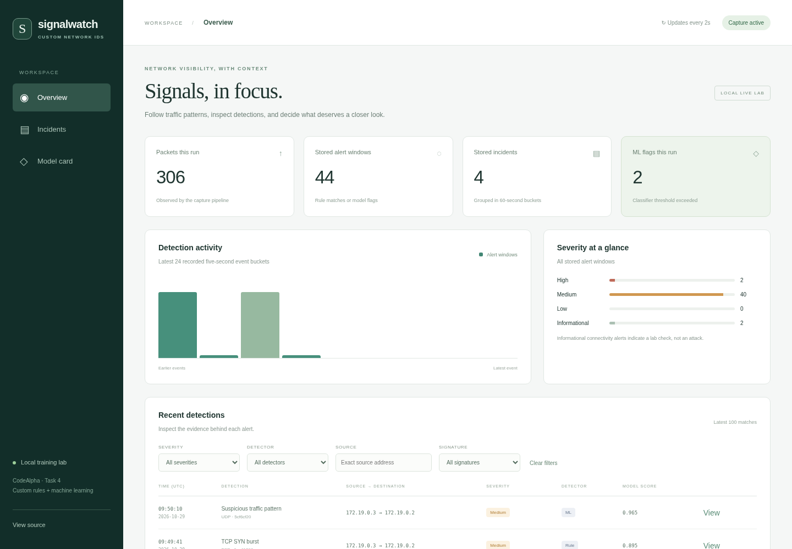

# Signalwatch: Custom Network IDS + Machine Learning

A **CodeAlpha Cyber Security Task 4** project with our own packet-to-incident detection pipeline. Scapy captures/decodes packets; our Python code extracts features and applies rules; scikit-learn provides a trained Random Forest. A local Flask dashboard shows the evidence.

**Read the [system report](reports/SYSTEM_REPORT.md), [PDF report](reports/SYSTEM_REPORT.pdf), and [model card](MODEL_CARD.md).** Source: [CodeAlpha_NetworkIntrusionDetectionSystem](https://github.com/cedric-malfoy/CodeAlpha_NetworkIntrusionDetectionSystem).

## What it does

- Continuously captures the mock server's Docker interface, or analyzes a saved PCAP without transmitting its packets.
- Applies five custom rules and a binary benign/suspicious classifier using the same 22-feature extractor during training and inference.
- Creates persistent SQLite incidents, console notifications, and investigation instructions. Repeated alert windows are grouped by source/destination in fixed 60-second event-time buckets.
- Shows Rule, ML, and Both detectors distinctly, with uncalibrated model scores, filters, incident records, capture health, model version, and held-out metrics.
- Supports JSON/CSV exports, independent lab fixtures, a pinned public dataset subset, and automated verification.

This is a local research/training system. The selected public benchmark has a **15.4% false-positive rate** at the frozen threshold. See the model card before interpreting a score as evidence of an attack.



## Start the Docker lab

Use Linux (or WSL) with Docker Engine and Docker Compose v2. The image contains the pinned Python dependencies and trained model; Node.js is only needed for browser tests.

```bash
git clone https://github.com/cedric-malfoy/CodeAlpha_NetworkIntrusionDetectionSystem.git
cd CodeAlpha_NetworkIntrusionDetectionSystem
docker compose build target
docker compose up -d --no-build
```

Open **http://127.0.0.1:8088/**. Wait for **Capture active**. The sensor shares the target container's network namespace; it sees traffic to that server. The lab network is internal, and the dashboard's published port binds to loopback.

Generate bounded scenarios against the named mock target:

```bash
docker compose run --rm traffic benign
docker compose run --rm traffic suspicious
docker compose run --rm traffic burst
```

`benign` sends normal HTTP/DNS traffic. `suspicious` exercises all five custom rules and includes a fixed-size UDP burst. `burst` independently sends variable-size UDP traffic to demonstrate a supported ML pattern. The latter is demonstration traffic, separate from frozen held-out evaluation. The model may miss fixed-size traffic; rule detections and ML outcomes are separate.

Alerts appear immediately for rules; ML decisions arrive when a five-second feature window closes. The page refreshes every two seconds. ICMP is labeled **informational**, not an intrusion.

```bash
docker compose logs -f sensor
docker compose exec sensor python -m ids_lab --database /data/ids.sqlite3 status
docker compose down
```

`down` stops this project's services while preserving its named data volume. To intentionally delete lab history, use `docker compose down --volumes`. No automatic firewall blocking, email, or external notifications are implemented.

The Docker build mounts a CA bundle as a BuildKit secret. On a managed cloud workspace with a read-only Docker cache, use `BUILDX_CONFIG=/tmp/codealpha-ids-buildx docker compose build target`. The default CA source is `/etc/ssl/certs/ca-certificates.crt`; `CODEX_PROXY_CERT` can select the configured proxy CA. Proxy settings and TLS verification remain enabled.

Newer Bake builders may request an explicit read entitlement for that public CA file. With the default CA path, use `docker buildx bake --file compose.yaml --allow=fs.read=/etc/ssl/certs/ca-certificates.crt --load target`. This grants access only to that file; the CA remains a secret mount outside image layers.

## Run offline with Python

Use Python 3.12. Install the pinned review tools, including test and PDF dependencies:

```bash
python3 -m venv .venv
source .venv/bin/activate
python -m pip install --upgrade pip
python -m pip install -r requirements-dev.txt
python tools/make_demo.py
python -m ids_lab --database runtime/replay.sqlite3 replay examples/scenarios.pcap
python -m ids_lab --database runtime/replay.sqlite3 status
python -m ids_lab --database runtime/replay.sqlite3 dashboard --port 8089
```

Open **http://127.0.0.1:8089/**. The supplied examples use documentation-only IP addresses and fixed locally administered MAC addresses. They contain no real capture data. Packet generation and offline analysis do not transmit packets.

```bash
python -m ids_lab --database runtime/replay.sqlite3 export --output artifacts/export
```

Exports contain `summary.json` and `alerts.csv`. The CLI's global `--database` option precedes the subcommand. Replaying the identical PCAP into the same database updates stable event IDs rather than creating duplicates.

## Model and measured results

The frozen Random Forest uses 200 trees, maximum depth 10, at most 256 leaves per tree, balanced bootstrap class weights, and seed 42. Its threshold **0.95** was selected using validation F1, with the higher threshold winning ties. No test-set tuning was performed.

| Held-out partition | Precision | Recall | F1 | False-positive rate |
| --- | --- | --- | --- | --- |
| Public IoT-23 subset: 187,534 labeled windows | 98.87% | 92.22% | 95.43% | 15.41% |
| Six independent lab sessions: 677 windows | 100.00% | 99.73% | 99.87% | 0.00% |

The public partition is 93.6% suspicious windows. An always-suspicious majority baseline gets **96.71% F1**, higher than this model's F1, but flags **100% of benign windows**. Our model's balanced accuracy is 88.40% versus that baseline's 50%. Raw results, including misses and false positives, are in [model_metrics.json](reports/model_metrics.json). A high headline metric alone would be misleading.

Model scores are uncalibrated classifier outputs. They are not probabilities that an intrusion occurred. Public capture windows are correlated, and IoT traffic from 2018–2019 is not representative of every current network.

## Training and evaluation notebook

Open [notebooks/01_training_evaluation.ipynb](notebooks/01_training_evaluation.ipynb) for a cell-by-cell reproduction using the shared feature/label pipeline, a fresh Random Forest, validation-only threshold selection, separate public/lab evaluation, plots, artifact export, and software tests. The original published model was produced by scripts; the notebook provides an interactive workflow without overwriting that model or its published reports.

```bash
source .venv/bin/activate
python -m pip install -r requirements-notebook.txt
python -m jupyterlab
```

Choose the `.venv` Python kernel, then **Restart Kernel and Run All Cells**. First-time preparation downloads approximately 100 MB; compatible data can be reused afterwards. Experimental outputs are kept under ignored `artifacts/notebook-runs/reproduction-v1/`. Read [notebooks/README.md](notebooks/README.md) for kernel registration, cache handling, and interpretation. Reproducing an already published test set is not a new blind evaluation.

## Reproduce the training

```bash
python tools/fetch_data.py
python tools/prepare_data.py
python tools/train_model.py
```

The selected public captures and labels total approximately 100 MB. The fetcher verifies `data/sources.lock.json` hashes, preserves attribution, and does not download or execute malware binaries. Public PCAPs are only analyzed offline. Downloads and processed arrays are ignored by Git and excluded from Docker builds.

The source manifest freezes entire captures into train/validation/test groups. Lab sessions use independent seeds and stay within one partition. Official labels are matched by bidirectional endpoints, protocol, and timestamps. Unmatched/ambiguous windows are excluded and counted in [data_quality.json](reports/data_quality.json); an infected capture is not labeled malicious wholesale.

The preparation tool reuses ignored per-capture feature caches. Remove `data/processed/` before changing decoder, feature, or label-join code, then retrain and evaluate the new version. A fresh clone has no processed caches.

Inputs are statistical features only: counts, network-layer byte lengths, timing, TCP flags, protocol indicators, and per-source connection/port diversity. Raw addresses, raw ports, absolute timestamps, dataset IDs, labels, and rule outputs are excluded from learned inputs. Metadata carries the schema, exact feature order, threshold, package versions, dataset hash, and artifact hash.

`joblib` is pickle-based: load only trusted project-generated artifacts and metadata. The hash checks integrity, not safety of arbitrary user-supplied models. There is no model-upload endpoint. A missing or incompatible model produces a visible degraded state while rules continue.

## Verification

```bash
python -m pytest -q
npm ci
npx playwright install chromium
npm run test:browser
python tools/verify_live.py
```

Browser tests use `/usr/bin/chromium` when present; otherwise Playwright's Chromium. Set `CHROMIUM_PATH` or `PYTHON` when needed. On Linux, `npx playwright install --with-deps chromium` installs browser system dependencies. Tests own and stop their temporary web server. The live verifier requires the built Docker image and leaves the lab running for inspection.

GitHub Actions checks feature/rule/storage/API tests, real offline integration, trusted model inference, browser behavior, and dependency advisories. Full public-data training is a separate reproducible command and does not run on every push.

Run `python tools/run_checks.py` to capture the Python/browser/dependency transcripts, versions, source commit, and file fingerprints under `reports/evidence/`. The final local suite contains **30 Python tests and five browser checks**. Live evidence is recorded separately by `tools/verify_live.py`.

## Native Linux capture

For an authorized local interface on your own Linux machine, initialize the virtual environment above and identify the correct interface with `ip link`:

```bash
sudo .venv/bin/python -m ids_lab --database runtime/live.sqlite3 live --interface eth0
```

Use a second terminal to start the read-only dashboard against that database. Ctrl+C or SIGTERM stops capture, drains queued packets, and records the stopped state. Capture requires raw-socket permission. The verified live mode for this delivery is the isolated Docker interface; native host capture instructions are not evidence of a separate host-interface test.

## Limits and project layout

The custom parser supports the documented lab HTTP/DNS cases, with bounded TCP reassembly. It is not a full TCP/IP inspection engine: fragments, encrypted payloads, HTTP/2, compressed/chunked request bodies, TCP sequence wraparound, and advanced evasion need additional design. Five-second and 60-second windows use fixed event-time boundaries, which can split activity at a boundary. Queue, flow, and stream limits are visible in health information.

`ids_lab/` contains our pipeline, rule matching, feature extraction, model loader, storage, CLI, and web API. `lab/` holds the mock services and bounded traffic generator. `tools/` provides data preparation, training, verification, fixtures, and PDF generation. `config/rules.json` contains configurable thresholds, stable IDs, severities, and response playbooks.

See [MODEL_CARD.md](MODEL_CARD.md), [SOURCES.md](SOURCES.md), and [DEMO_AND_SUBMISSION.md](DEMO_AND_SUBMISSION.md). Tasks 1–3 are unchanged.
